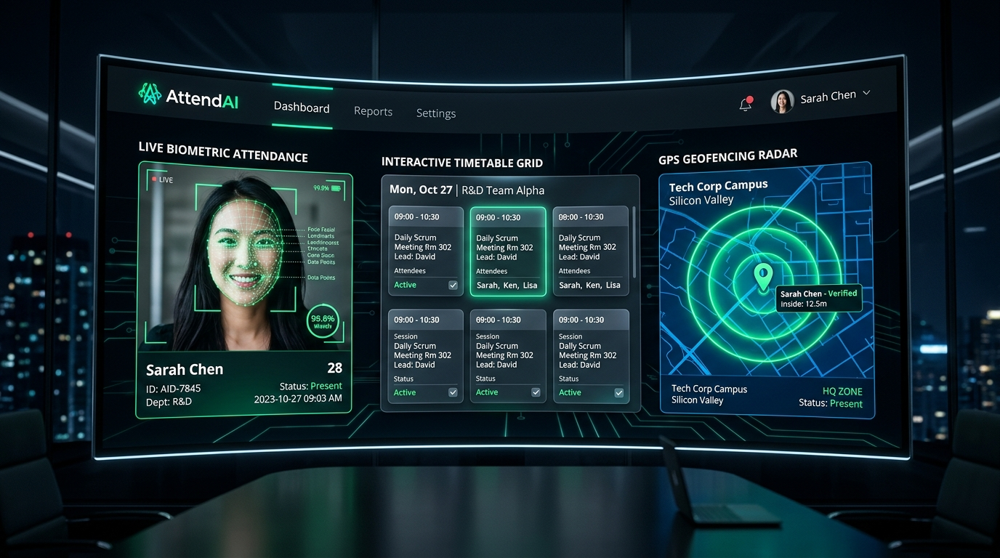
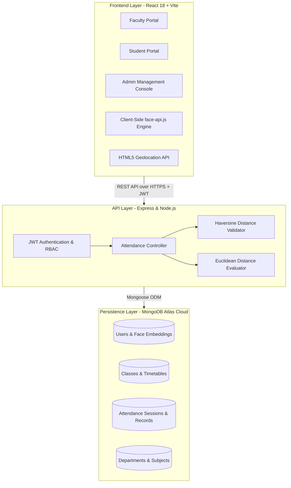
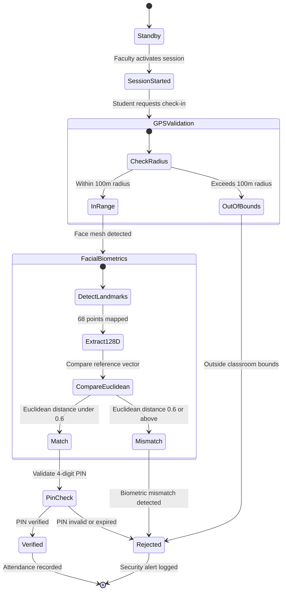
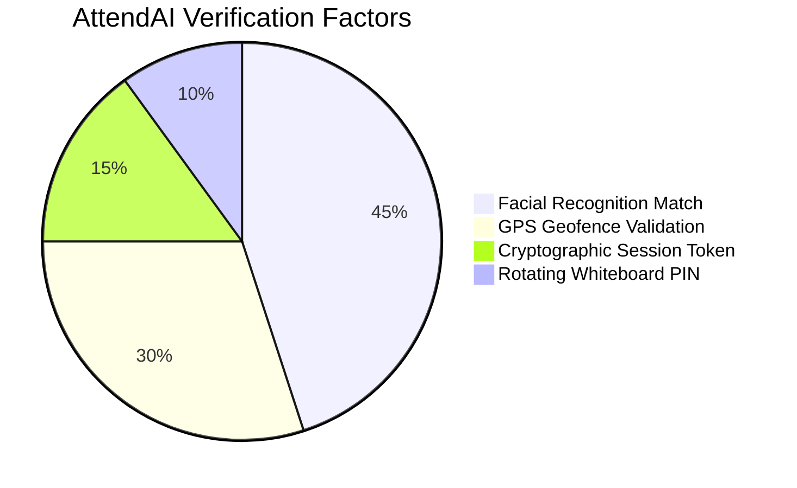
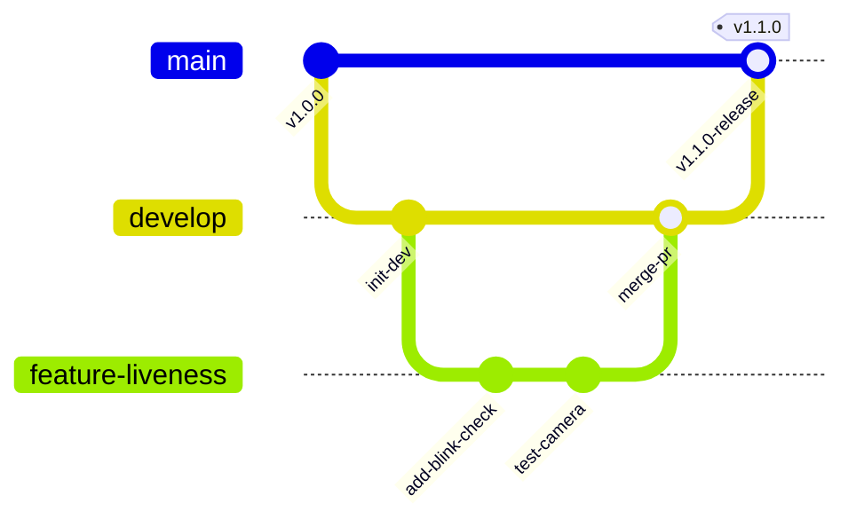

<div align="center">

# 🎓 AttendAI
### Next-Generation Smart Biometric & Geofenced Attendance Platform

[](LICENSE)
[](https://nodejs.org/)
[](https://react.dev/)
[](https://vitejs.dev/)
[](https://www.mongodb.com/atlas)
[](https://tailwindcss.com/)
[](https://justadudewhohacks.github.io/face-api.js/docs/index.html)
[](CONTRIBUTING.md)

<br />



<br /><br />

<p align="center">
  <b>AttendAI</b> is an enterprise-grade academic platform built to completely eradicate proxy attendance (buddy punching). <br />
  Powered by in-browser deep neural networks, GPS geofencing, and rotating cryptographic tokens.
</p>

[Explore Docs](#-system-architecture) • [Verification Flow](#-student-verification-lifecycle) • [Session Timeline](#-live-session-lifecycle) • [Setup Guide](#-installation--setup) • [Contribute](#-contributing-guidelines) • [Report Bug](https://github.com/Abhiii8/AttendAi/issues)

</div>

---

## 📑 Table of Contents

- [Vision & Problem Statement](#-vision--problem-statement)
- [Key Features Matrix](#-key-features-matrix)
- [System Architecture](#-system-architecture)
- [Student Verification Lifecycle (State Graph)](#-student-verification-lifecycle)
- [Live Session Lifecycle (Gantt Chart)](#-live-session-lifecycle)
- [Multi-Factor Security Breakdown (Chart)](#-multi-factor-security-breakdown)
- [Role-Based Portals](#-role-based-portals)
- [Repository Structure](#-repository-structure)
- [Installation & Setup](#-installation--setup)
- [Mobile Device Testing](#-mobile-device-testing)
- [Contributing Guidelines & Git Workflow](#-contributing-guidelines)
- [Roadmap](#-roadmap)
- [License & Authors](#-license--authors)

---

## 💡 Vision & Problem Statement

Traditional university roll calls and static RFID badge scans suffer from three major vulnerabilities:
1. **Buddy Punching / Proxy Attendance:** Students hand badges to friends or share static QR code screenshots from their dorm rooms.
2. **Administrative Time Loss:** Lecturers waste 10–15 minutes per lecture manually calling names.
3. **Data Fragmentation:** Paper logs or isolated spreadsheets make institutional analytics difficult.

> [!IMPORTANT]
> **How AttendAI Solves This:**
> AttendAI combines **4 simultaneous verification layers**:
> 1. **Live Biometric Facial Recognition** (128-dimensional Euclidean distance matching).
> 2. **GPS Geofencing** (Haversine distance calculation requiring physical presence within 100 meters).
> 3. **Dynamic Cryptographic Session Tokens** (expired after lecture window).
> 4. **Randomized 4-Digit In-Class PIN** (projected live on the whiteboard).

---

## 📊 Key Features Matrix

| Feature | Traditional Roll Call | Standard QR Systems | AttendAI Platform |
| :--- | :---: | :---: | :---: |
| **Proxy Elimination** | ❌ Easy to proxy | ❌ Screenshots shared | ✅ **100% Prevented** |
| **Verification Speed** | ⏱️ 10–15 minutes | ⚡ ~5 seconds | ⚡ **Instant (~3 seconds)** |
| **Physical Presence** | ⚠️ Unreliable | ❌ Can mark from home | ✅ **Enforced via GPS (100m)** |
| **Identity Verification**| 👁️ Manual inspection | ❌ None | 🤖 **AI Facial Embeddings** |
| **Reporting & Export** | 📄 Manual paperwork | ⚠️ Basic logs | 📊 **1-Click CSV & PDF Exports** |
| **Timetable Scheduling** | ❌ Separate systems | ❌ None | 📅 **Interactive Visual Grid** |

---

## 🏗 System Architecture

The application adopts a decoupled client-server architecture utilizing the **MERN** stack (MongoDB, Express, React, Node.js).



---

## 🔄 Student Verification Lifecycle

The following state machine diagram illustrates the strict validation sequence a student undergoes when marking attendance:



---

## ⏱️ Live Session Lifecycle

This timeline tracks how a typical 15-minute lecture check-in window functions for faculty and students:

```mermaid
gantt
    title Lecture Attendance Session Lifecycle (09:00 - 09:15 AM)
    dateFormat HH:mm
    axisFormat %H:%M

    section Faculty Workflow
    Open Timetable & Select Class    :done, 09:00, 09:01
    GPS Lock & Session Broadcast      :done, 09:01, 09:02
    Whiteboard PIN Active             :active, 09:02, 09:12
    Auto-Close Session & CSV Export   :crit, 09:12, 09:15

    section Student Workflow
    Classroom Arrival                 :done, 09:00, 09:03
    Scan & Biometric Authentication   :active, 09:03, 09:07
    Instant Confirmation Notification :milestone, 09:07, 09:08
```



---

## 🛡️ Multi-Factor Security Breakdown

Why AttendAI is virtually impossible to fool:



---

## 👥 Role-Based Portals

<details>
<summary><b>🛡️ 1. Administrator Dashboard</b> (Click to expand)</summary>

* **System Overview:** Live statistical counters for total students, faculty members, registered departments, and subjects.
* **Academic Structure:** Add, edit, and organize university departments and academic courses.
* **User Provisioning:** Create faculty and student profiles with automated enrollment sequence generator (`2026001`, `2026002`, etc.).
* **Audit Logs:** Institutional visibility into attendance records across all departments.
</details>

<details>
<summary><b>👨‍🏫 2. Faculty Dashboard</b> (Click to expand)</summary>

* **Interactive Timetable:** Drag-and-drop / click-to-schedule weekly classes with room allocations.
* **1-Click Live Session:** Start a lecture session with automatic GPS geofencing radius locking.
* **Class Management:** Manage enrolled students and upload reference passport photos for facial recognition.
* **Session Analytics & Export:** View session-by-session student presence and download comprehensive CSV spreadsheets.
* **PDF Timetable Export:** Formatted high-definition print stylesheets for physical notice boards (<kbd>Ctrl</kbd> + <kbd>P</kbd>).
</details>

<details>
<summary><b>🎓 3. Student Dashboard</b> (Click to expand)</summary>

* **"Active Now" Card:** Automatically detects ongoing lectures for instant 1-click biometric check-in.
* **Webcam Face ID Scan:** Real-time AI face mesh detection with live landmark mapping.
* **Attendance History:** Chronological timeline tracking subject-wise attendance percentages with warning badges when below 75%.
</details>

---

## 🔒 Biometric Privacy & Security

> [!NOTE]
> **No Raw Photos Stored:**
> For maximum student privacy and compliance with data privacy regulations, AttendAI **never stores raw biometric photos** on the server.
>
> 1. The client's browser extracts a mathematical vector of **128 floating-point numbers** (face embedding).
> 2. Only this irreversible numeric array is saved in MongoDB.
> 3. Even in the event of a database compromise, original face photographs cannot be reconstructed from embeddings.

---

## 📁 Repository Structure

```text
Attendai/
├── backend/                  # Express REST API Server
│   ├── src/
│   │   ├── config/           # MongoDB Atlas & in-memory fallback config
│   │   ├── controllers/      # Auth, Admin, Class, and Attendance controllers
│   │   ├── middleware/       # JWT auth & RBAC route protection
│   │   ├── models/           # Mongoose schemas (User, Class, Attendance, etc.)
│   │   └── routes/           # RESTful API route definitions
│   ├── .env.example          # Environment variables template
│   ├── seed.js               # Admin account seed script
│   └── server.js             # Server entry point
├── frontend/                 # React + Vite Single Page Application
│   ├── public/               # Static assets & face-api.js neural weights
│   ├── src/
│   │   ├── assets/           # Project imagery & icons
│   │   ├── components/       # Reusable components & Glassmorphic Layout
│   │   ├── pages/            # Role-specific dashboard views & scanner
│   │   ├── services/         # Axios API communication wrappers
│   │   └── index.css         # Modern styling & animation keyframes
│   └── vite.config.js        # Vite build & network host configuration
├── docs/                     # Architectural documentation, UML diagrams & media
│   └── assets/               # High-resolution screenshots & UI mockups
├── .gitignore                # Production ignore rules (securing .env & node_modules)
├── run.bat                   # 1-Click concurrent runner for Windows
├── CONTRIBUTING.md           # Open-source contribution guidelines
└── README.md                 # Project documentation
```

---

## 🚀 Installation & Setup

### Prerequisites
* [Node.js](https://nodejs.org/) (Version 18.0.0 or higher)
* [Git](https://git-scm.com/) installed
* A free [MongoDB Atlas](https://www.mongodb.com/cloud/atlas) cluster (or local MongoDB)

### 1. Clone the Repository
```bash
git clone https://github.com/Abhiii8/AttendAi.git
cd AttendAi
```

### 2. Install Dependencies
```bash
# Install backend packages
cd backend
npm install

# Install frontend packages
cd ../frontend
npm install
cd ..
```

### 3. Environment Configuration
Create a `.env` file inside the `backend/` directory:

```env
PORT=5000
MONGO_URI=mongodb+srv://<username>:<password>@cluster0.mongodb.net/attendai?retryWrites=true&w=majority
JWT_SECRET=your_super_secret_jwt_key_here
```

> [!TIP]
> **MongoDB Network Access:** Make sure your current IP address is whitelisted in your **MongoDB Atlas > Security > Network Access** settings (or set to `0.0.0.0/0` for development).

### 4. Seed Default Admin Account (Optional)
```bash
cd backend
node seed.js
```

### 5. Run the Application
You can launch both the frontend and backend servers together using the Windows batch launcher:
```bash
.\run.bat
```
Or start them manually in separate terminal windows:

**Terminal 1 (Backend):**
```bash
cd backend
npm run dev
```

**Terminal 2 (Frontend):**
```bash
cd frontend
npm run dev
```

Open **`http://localhost:5173`** in your browser.

---

## 📱 Mobile Device Testing

Because laptop webcams are often stationary, testing student attendance works best on a mobile device:

1. Connect your computer and your phone to the same Wi-Fi network.
2. In your terminal, notice the **Network URL** generated by Vite (e.g. `http://192.168.1.X:5173`).
3. Open that URL on your phone's browser, grant camera and location permissions, and test live face verification!

---

## 🤝 Contributing Guidelines

We welcome contributions from the open-source community! Follow these steps to build features or fix bugs:

### Git Branching Workflow



### Step-by-Step Contribution:
1. **Fork the repo** to your personal GitHub account.
2. **Clone your fork**:
   ```bash
   git clone https://github.com/<your-username>/AttendAi.git
   cd AttendAi
   ```
3. **Create a descriptive feature branch**:
   ```bash
   git checkout -b feature/blink-liveness-check
   ```
4. **Commit using Conventional Commits**:
   ```bash
   git commit -m "feat(biometrics): integrate blink challenge detection"
   ```
5. **Push to your fork and submit a PR**:
   ```bash
   git push origin feature/blink-liveness-check
   ```

*Check out our full [CONTRIBUTING.md](CONTRIBUTING.md) for code styling guidelines, testing rules, and PR checklist.*

---

## 🗺 Roadmap

- [x] MERN Foundation & Secure JWT RBAC
- [x] Client-side face embeddings extraction via `face-api.js`
- [x] Haversine GPS Geofencing radius validation
- [x] Interactive Faculty Timetable & PDF generator
- [x] 1-Click CSV attendance data export
- [ ] **Liveness Detection:** Blink and head-movement challenge to prevent photo spoofing.
- [ ] **Progressive Web App (PWA):** Installable offline app with push notifications when lecture starts.
- [ ] **Predictive AI Analytics:** Machine learning models forecasting at-risk students before final exams.

---

## 📜 License & Authors

Distributed under the **MIT License**. See [`LICENSE`](LICENSE) for more information.

* **Lead Maintainer:** [Abhi Patel](https://github.com/Abhiii8)
* **Organization:** AttendAI Open Source Initiative

<div align="center">
  <sub>Built with ❤️ for universities and academic institutions everywhere.</sub>
</div>
