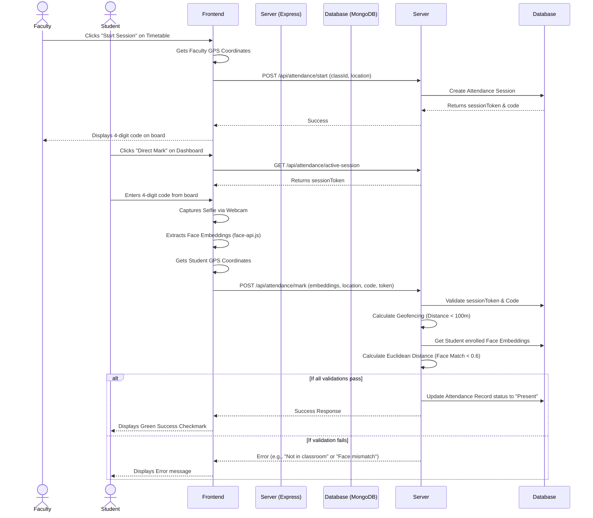

# AttendAI UML Diagrams

This document outlines the core architecture and flows of the AttendAI system.

---

## 1. Entity-Relationship (ER) Diagram
This diagram maps the relationships between the core data structures in the database.

```mermaid
erDiagram
    DEPARTMENT ||--o{ USER : contains
    DEPARTMENT ||--o{ SUBJECT : teaches
    USER ||--o{ CLASS : "teaches (Faculty)"
    USER ||--o{ CLASS : "enrolled in (Student)"
    SUBJECT ||--o{ CLASS : includes
    CLASS ||--o{ ATTENDANCE : "has sessions"
    USER ||--o{ ATTENDANCE : "marked in records"

    DEPARTMENT {
        ObjectId _id PK
        String name
        String code
    }

    USER {
        ObjectId _id PK
        String name
        String email
        String role
        ObjectId department FK
        Array faceEmbeddings
    }

    SUBJECT {
        ObjectId _id PK
        String name
        String code
        ObjectId department FK
    }

    CLASS {
        ObjectId _id PK
        String name
        ObjectId subject FK
        ObjectId faculty FK
        Array students FK
        Array schedule
    }

    ATTENDANCE {
        ObjectId _id PK
        ObjectId class FK
        ObjectId faculty FK
        String sessionToken
        String attendanceCode
        Object location
        Array records
    }
```

---

## 2. Direct Marking Sequence Diagram
This diagram illustrates the complex flow of the AI-powered attendance marking process.



---

## 3. High-Level Architecture Diagram
This diagram provides a birds-eye view of how the system components interact.

```mermaid
flowchart TD
    %% User Interfaces
    subgraph Client [Frontend (React + Vite)]
        A1[Faculty Dashboard]
        A2[Student Dashboard]
        A3[Admin Panel]
        
        B1[Face-API.js AI Module]
        B2[Browser Geolocation API]
    end

    %% Communication Protocol
    Client -- "REST API (JSON) + JWT" --> Server

    %% Backend Server
    subgraph Server [Backend (Node.js + Express)]
        C1[Auth Middleware]
        C2[Attendance Controller]
        C3[Admin/Faculty Controllers]
        
        C1 --> C2
        C1 --> C3
    end

    %% Database Storage
    Server -- "Mongoose ODM" --> DB

    subgraph DB [Database (MongoDB)]
        D1[(Users Collection)]
        D2[(Classes Collection)]
        D3[(Attendance Collection)]
    end
```
